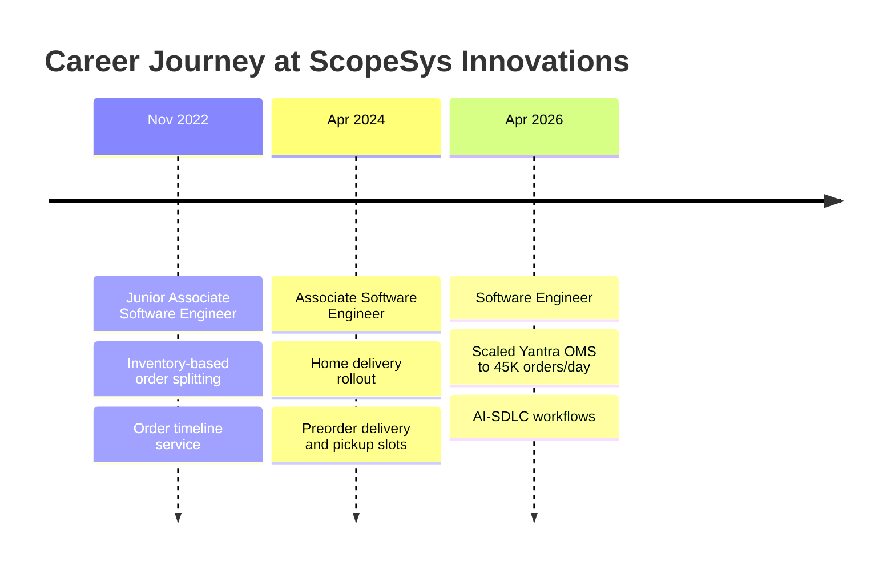

<!-- Animated header -->
<div align="center">


<a href="https://github.com/sanchit-s-gupta">
  
</a>

<br/>

<a href="https://sanchit-s-gupta.github.io/"></a>
<a href="https://www.linkedin.com/in/sanchit-s-gupta/"></a>
<a href="mailto:sanchit2807@gmail.com"></a>


</div>

---

##  About Me

I'm a **Software Engineer with 3+ years of experience** building Java backends for **order management systems**, **microservices**, and **enterprise application integrations**. I work on **Yantra OMS** for a leading U.S. retailer, where I've helped scale the platform from **1,000 to 45,000 daily orders** without breaking fulfillment.

I like making systems faster and more reliable, and I'm increasingly building with **AI-assisted development** (GitHub Copilot, context files, and coding guidelines) to speed up analysis, refactoring, and testing.

```java
public class Sanchit extends SoftwareEngineer {
    String location   = "Pune, India";
    String focus      = "Order Management | Microservices | Backend Performance";
    String currently  = "Engineering AI-SDLC workflows with GitHub Copilot";
    String learning[] = { "Spring AI", "Claude Code", "Apache Kafka" };
}
```

---

## 📈 Impact at a Glance

<div align="center">

| 🚀 Scale | ⚡ API Speed | 🗄️ Data Retrieval | 🧪 Test Coverage |
|:---:|:---:|:---:|:---:|
| **1K → 45K** daily orders | **−40%** avg response time | **−35%** query time | **75%** across tested services |

| 🛠️ Incident Resolution | 🔎 Support Investigation | 📦 Fulfillment Exceptions | 🗓️ Slot Selection |
|:---:|:---:|:---:|:---:|
| **−30%** resolution time | **−20%** status investigation time | **−15%** inventory-related | **+18%** completion |

</div>

---

## 💼 Experience



<details open>
<summary><b>🔹 Software Engineer — ScopeSys Innovations Pvt. Ltd. <i>(Apr 2026 – Present)</i></b></summary>
<br/>

- Integrated shipment partners into **Yantra OMS**, expanding catalog capabilities while keeping fulfillment workflows intact
- Scaled Yantra OMS for a leading U.S. retailer, growing daily order volume from **1,000 to 45,000** with continuous order processing
- Optimized SQL queries and indexes, cutting data retrieval time by **35%**
- Built **Spring Boot microservices and REST APIs** for order workflows, reducing average API response time by **40%**
- Engineered **AI-SDLC workflows** with GitHub Copilot, context files, and coding guidelines to analyze dependencies, generate code, refactor, and create validated JUnit/Mockito tests

</details>

<details>
<summary><b>🔹 Associate Software Engineer — ScopeSys Innovations Pvt. Ltd. <i>(Apr 2024 – Mar 2026)</i></b></summary>
<br/>

- Orchestrated the **home delivery rollout** by integrating delivery partners into existing pickup workflows
- Delivered **preorder delivery and pickup slots**, increasing selection completion by **18%**
- Diagnosed critical production defects via log analysis and root-cause investigation, cutting average incident resolution time by **30%**
- Validated order management microservices with JUnit and Mockito, maintaining **75% code coverage** and catching regressions before production

</details>

<details>
<summary><b>🔹 Junior Associate Software Engineer — ScopeSys Innovations Pvt. Ltd. <i>(Nov 2022 – Mar 2024)</i></b></summary>
<br/>

- Implemented **inventory-based order splitting** during the store pickup rollout, reducing inventory-related fulfillment exceptions by **15%**
- Developed cloud-based backend features and service integrations for data processing
- Introduced an **order timeline service** consolidating lifecycle events, reducing status investigation time by **20%**
- Analyzed **MapStruct** and **Liquibase** to standardize object mapping and database migrations across OMS services

</details>

---

## 🛠️ Tech Stack

<div align="center">


<br/><br/>


</div>

---

## 🎓 Education & Certifications

| 🎓 Education | |
|---|---|
| **B.E. in Computer Science**, Shri Govindrao Wanjari College of Engineering and Technology | 2018 – 2021 · CGPA **9.2 / 10** |
| **Diploma in Computer Technology**, KDK College of Engineering | 2015 – 2018 · CGPA **7.7 / 10** |

**📜 Certifications**
- 🤖 **Claude Code in Action**, Anthropic
- 🌱 **Spring AI** and **Java & Spring Boot**, Udemy
- 📡 **Apache Kafka**, Udemy

---

## 📊 GitHub Stats

<div align="center">


<br/>


<br/>


</div>

---

## 📫 Let's Connect

<div align="center">

I'm always happy to talk about **backend engineering, order management systems, microservices, and AI-assisted development**.

<a href="https://www.linkedin.com/in/sanchit-s-gupta/"></a>
<a href="mailto:sanchit2807@gmail.com"></a>


</div>
